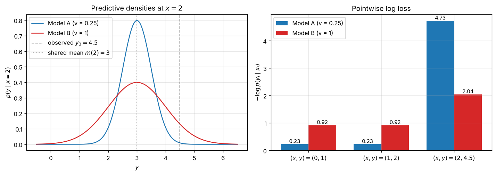
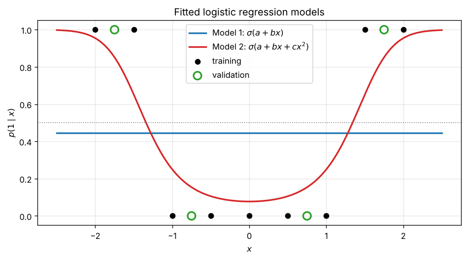
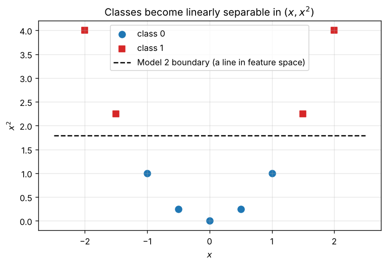

# Conditional Models: Why Log Loss Sees What Squared Error Misses

[](https://github.com/Nobleteesage/conditional-models-logloss/actions/workflows/tests.yml)
[](https://colab.research.google.com/github/Nobleteesage/conditional-models-logloss/blob/main/notebooks/HW4A_Conditional_Models.ipynb)


A small, fully reproducible study of **conditional probabilistic models** $p_\theta(y \mid x)$, built around two questions:

1. **Regression:** two Gaussian models make *identical* point predictions. Why can one have a much better log loss than the other, and why can that ranking flip when one data point is removed?
2. **Classification:** when the class pattern is symmetric (positives at both ends, negatives in the middle), what does plain logistic regression get wrong, and how does a single quadratic feature fix it?

The project was developed as Homework 4A for the course *Machine Learning: Mathematical Basis* (D.B. Rokhlin, 2026) in the MSc programme Applied Mathematics and Informatics at Southern Federal University, and extended here into a standalone repository with reusable code, tests and additional figures.

---

## Table of contents

* [Background](#background)
* [Experiment 1: Gaussian models with the same mean](#experiment-1-gaussian-models-with-the-same-mean)
* [Experiment 2: Logistic regression with nonlinear features](#experiment-2-logistic-regression-with-nonlinear-features)
* [Key takeaways](#key-takeaways)
* [Repository structure](#repository-structure)
* [How to reproduce](#how-to-reproduce)
* [Author](#author)

---

## Background

A conditional model outputs a full probability distribution over $y$ for each input $x$, not just a single number. The natural way to score it on validation data $\{(x_i, y_i)\}_{i=1}^n$ is the **average negative log likelihood**, or log loss:

$$
L = -\frac{1}{n}\sum_{i=1}^{n} \log p_\theta(y_i \mid x_i).
$$

Log loss is a *proper scoring rule*: it is minimised in expectation only by the true conditional distribution. It therefore rewards both an accurate centre **and** honest uncertainty. A point metric such as squared error only evaluates the centre.

---

## Experiment 1: Gaussian models with the same mean

### Setup

| Model | Conditional distribution | Standard deviation |
|---|---|---|
| A | $Y \mid X = x \sim \mathcal N(1 + x,\ 0.25)$ | 0.5 (confident) |
| B | $Y \mid X = x \sim \mathcal N(1 + x,\ 1)$ | 1.0 (cautious) |

Validation data: $(x, y) \in \{(0, 1),\ (1, 2),\ (2, 4.5)\}$. For a Gaussian $\mathcal N(m, v)$,

$$
-\log p(y) = \tfrac12 \log(2\pi v) + \frac{(y - m)^2}{2v}.
$$

The first term rewards small variance; the second punishes errors, and punishes them harder when the variance is small. The residuals $y_i - (1 + x_i)$ are $0,\ 0,\ 1.5$.

### Results

| Model | Loss at $(0,1)$ | Loss at $(1,2)$ | Loss at $(2,4.5)$ | **Average, 3 points** | **Average, first 2** | Prediction at $x = 3$ |
|---|---|---|---|---|---|---|
| A ($v = 0.25$) | 0.2258 | 0.2258 | 4.7258 | 1.7258 | **0.2258** | 4 |
| B ($v = 1$) | 0.9189 | 0.9189 | 2.0439 | **1.2939** | 0.9189 | 4 |



### Interpretation

* **On all three points, Model B wins** (1.2939 vs 1.7258). The third observation lies 1.5 units from the mean. For Model A that is 3 standard deviations, a penalty of $1.5^2/(2 \cdot 0.25) = 4.5$; for Model B it is only 1.5 standard deviations, a penalty of $1.125$.
* **On the first two points alone, Model A wins** (0.2258 vs 0.9189). Both residuals are zero, so only the normalising term $\tfrac12\log(2\pi v)$ remains, and a narrower density places more mass exactly where the data are.
* **Both models predict $\hat y = 4$ at $x = 3$.** Under squared error the optimal prediction is the conditional mean, which the models share, so squared error cannot tell them apart. Log loss can, because the variance enters both of its terms.

> Confidence is rewarded when it is justified and punished severely when it is not. A single surprising observation is enough to reverse the ranking of two models.

---

## Experiment 2: Logistic regression with nonlinear features

### Setup

| | values |
|---|---|
| Training $x$ | −2, −1.5, −1, −0.5, 0, 0.5, 1, 1.5, 2 |
| Training $y$ | 1, 1, 0, 0, 0, 0, 0, 1, 1 |
| Validation $x$ | −1.75, −0.75, 0.75, 1.75 |
| Validation $y$ | 1, 0, 0, 1 |

Two models, fitted with `sklearn.linear_model.LogisticRegression(C=1, max_iter=1000)` (L2 regularisation):

* **Model 1:** $p(1 \mid x) = \sigma(a + bx)$
* **Model 2:** $p(1 \mid x) = \sigma(a + bx + cx^2)$, by adding $x^2$ as a second feature

### Results

| Model | $a$ | $b$ | $c$ | Validation log loss | Validation accuracy |
|---|---|---|---|---|---|
| Model 1 (linear) | −0.2231 | 0.0000 | | 0.6994 | 0.50 |
| Model 2 (quadratic) | −2.4806 | 0.0000 | 1.3805 | **0.1639** | **1.00** |

Predicted probabilities on the validation set:

| $x$ | $y$ | Model 1 $p(1 \mid x)$ | Model 2 $p(1 \mid x)$ |
|---|---|---|---|
| −1.75 | 1 | 0.4445 | 0.8516 |
| −0.75 | 0 | 0.4445 | 0.1539 |
| 0.75 | 0 | 0.4445 | 0.1539 |
| 1.75 | 1 | 0.4445 | 0.8516 |



### Interpretation

* **Model 1 cannot represent the pattern.** A linear logit makes $p(1 \mid x)$ monotone in $x$, so it can never be high at both ends. Because the data are symmetric, the optimum is $b = 0$: a flat line at $\sigma(a) = 4/9$, the share of positives in the training set. It predicts class 0 everywhere, and its log loss is close to $\log 2 \approx 0.693$, the value of pure guessing.
* **Model 2 matches the shape of the data.** With $c > 0$ the logit is a U shaped parabola, giving low probability in the middle and high probability at both ends. The two decision boundaries sit at $x = \pm\sqrt{-a/c} \approx \pm 1.34$.
* **Why one extra feature is enough.** In the feature space $(x, x^2)$ the two classes are separated by a straight line, so a *linear* classifier in that space becomes a *nonlinear* classifier in the original $x$:



* The curve is smooth rather than a step function because $C = 1$ applies L2 regularisation, which keeps the coefficients finite even though the training data are perfectly separable.

---

## Key takeaways

1. **Evaluate distributions with distributional metrics.** Two models with the same point predictions can differ greatly in quality; log loss reveals how well each model's stated uncertainty matches reality.
2. **Log loss is sensitive to overconfidence.** Its penalty grows with the squared standardised error, so small validation sets can produce unstable rankings.
3. **Model capacity must match the structure of the problem.** Logistic regression is linear in its features, not in the raw input. Choosing the right features (here $x^2$) turns an unsolvable problem into an easy one.

---

## Repository structure

```
conditional-models-logloss/
├── notebooks/
│   └── HW4A_Conditional_Models.ipynb   # executed notebook with derivations, code and plots
├── src/
│   ├── __init__.py
│   └── conditional_models.py           # reusable model and evaluation functions
├── tests/
│   └── test_conditional_models.py      # checks against hand derived values
├── figures/                            # generated by run_experiments.py
│   ├── gaussian_models.png
│   ├── logistic_fits.png
│   └── feature_space.png
├── results/                            # generated by run_experiments.py
│   ├── gaussian_log_loss.csv
│   ├── logistic_metrics.csv
│   └── logistic_validation_predictions.csv
├── .github/workflows/tests.yml         # runs the tests on every push
├── run_experiments.py                  # reproduces every number and figure in this README
├── requirements.txt
├── pytest.ini
├── LICENSE
└── README.md
```

---

## How to reproduce

**Option 1: in the browser.** Click the *Open in Colab* badge at the top and choose *Runtime → Run all*.

**Option 2: locally.**

```bash
git clone https://github.com/Nobleteesage/conditional-models-logloss.git
cd conditional-models-logloss
python -m venv .venv
source .venv/bin/activate          # on Windows: .venv\Scripts\activate
pip install -r requirements.txt

python run_experiments.py          # regenerates figures/ and results/
python -m pytest                   # runs the test suite
jupyter notebook notebooks/        # optional: open the notebook
```

All computations are deterministic, so the numbers above are reproduced exactly.

---

## Author

**Goriola-Obafemi Babatunde Sukanmi**
MSc Applied Mathematics and Informatics (Modern Software Development), Southern Federal University

* GitHub: [@Nobleteesage](https://github.com/Nobleteesage)
* ORCID: [0009-0000-2865-5242](https://orcid.org/0009-0000-2865-5242)
* Email: goriolaobafemi@gmail.com

## Acknowledgements

Problem formulation from Homework 4A of *Machine Learning: Mathematical Basis* by D.B. Rokhlin (Southern Federal University, 2026).

## License

Released under the [MIT License](LICENSE).
